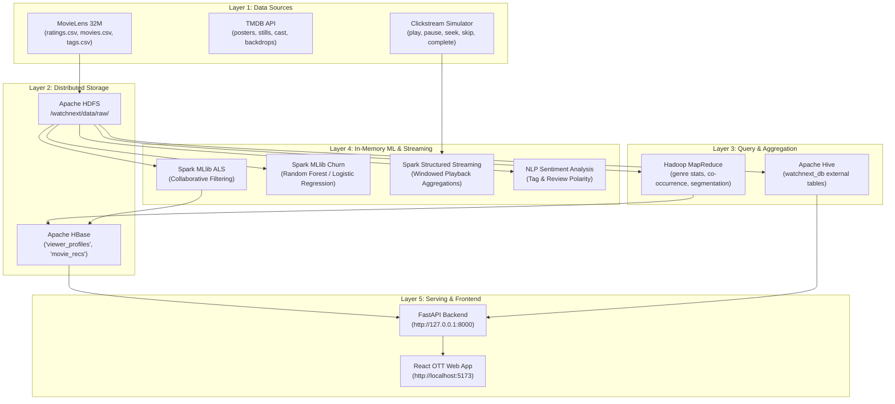

# WatchNext — Person 2: Big Data Analytics Pipeline

> **Course:** Big Data Analytics (BDA) Laboratory — Experiment 1  
> **Student:** Nikhil Kadam (D20A - 12)  
> **Role:** Person 2 — Big Data Pipeline Developer  
> **Domain:** Entertainment & OTT (MovieLens 32M + TMDB)  
> **Architecture:** 5-Layer Hadoop Ecosystem Pipeline  

---

## 1. Pipeline Overview & Architecture

WatchNext is an OTT personalized recommendation and viewer engagement analytics platform. While Person 1 develops the consumer-facing React application, Person 2 develops the offline batch, streaming, and machine learning pipeline powering all recommendations, demand forecasts, and engagement analytics.



---

## 2. Directory Layout

```
pipeline/
├── README.md                      # This documentation guide
├── run_pipeline.py                # Master orchestrator running all pipeline jobs
├── ingest/
│   ├── hdfs_upload.sh             # HDFS directory creation and raw dataset ingestion
│   └── data_profiler.py           # 5 Vs veracity check and quality auditor
├── mapreduce/
│   ├── mr_genre_stats.py          # Job 1: Genre rating distribution & averages
│   ├── mr_movie_ratings.py        # Job 2: Movie rating counts, mean & ranking
│   ├── mr_item_similarity.py      # Job 3: Item-to-item co-occurrence & Jaccard similarity
│   └── mr_user_activity.py        # Job 4: User rating frequency & activity tiers
├── hive/
│   ├── schema.hql                 # External table DDLs mapped to HDFS
│   └── analytics.hql              # Analytical SQL queries for BI dashboard
├── hbase/
│   ├── hbase_schema.txt           # HBase table definitions (viewer_profiles, movie_recs)
│   └── hbase_manager.py           # Python HBase interface (fast read/write lookups)
├── spark/
│   ├── spark_als_recommender.py   # Matrix Factorization via ALS Collaborative Filtering
│   ├── spark_churn_prediction.py  # Subscriber churn prediction model
│   ├── spark_streaming.py         # Structured Streaming for real-time playback logs
│   └── sentiment_analyzer.py      # Sentiment polarity & mood classification on tags
├── simulator/
│   └── event_simulator.py         # High-velocity playback event generator
└── output/                        # Precomputed pipeline artifacts for backend serving
    ├── data_quality_report.json
    ├── mr_genre_stats.json
    ├── mr_movie_ratings.json
    ├── mr_item_similarity.json
    ├── mr_user_segments.json
    ├── als_recommendations.json
    ├── churn_predictions.json
    ├── sentiment_scores.json
    └── master_pipeline_analytics.json
```

---

## 3. Justification of the 5 Vs of Big Data

| Big Data 'V' | OTT Context in WatchNext | Implementation in Pipeline |
|---|---|---|
| **Volume** | 32+ million ratings, 87,000+ movies, 200,000+ users | Stored in HDFS blocks; processed in parallel using MapReduce and Spark MLlib. |
| **Velocity** | Streaming playback events (play, pause, skip, seek, complete) arriving continuously | Ingested and windowed in real-time via Spark Structured Streaming and Event Simulator. |
| **Variety** | Structured ratings/movies, semi-structured TMDB JSON metadata, unstructured tags | Stored across HDFS (CSV), Hive (structured tables), HBase (columnar NoSQL), and NLP pipelines. |
| **Veracity** | Outlier ratings, sarcasm, cold-start sparsity, noise in user tags | Managed via data profiler, minimum-rating significance filters, and NLP sentiment scoring. |
| **Value** | Converting raw logs into hyper-personalized recommendations and business forecasts | Powers iFlix personalized Marquee, churn risk mitigation alerts, and the business BI dashboard. |

---

## 4. Execution Commands (Dual Environment Support)

### Option A: Local Execution (Instant Demo / Standalone Mode)

Run the master orchestrator to execute all 8 Big Data jobs end-to-end:

```powershell
python pipeline/run_pipeline.py
```

Run the real-time playback event simulator:

```powershell
python pipeline/simulator/event_simulator.py 50
```

### Option B: Cloudera QuickStart VM / Production Hadoop Cluster

1. **HDFS Ingestion:**
   ```bash
   bash pipeline/ingest/hdfs_upload.sh
   ```

2. **MapReduce Batch Jobs (Hadoop Streaming):**
   ```bash
   hadoop jar /usr/lib/hadoop-mapreduce/hadoop-streaming.jar \
     -file pipeline/mapreduce/mr_genre_stats.py \
     -mapper "python mr_genre_stats.py --mapper" \
     -reducer "python mr_genre_stats.py --reducer" \
     -input /watchnext/data/raw/ratings/ratings.csv \
     -output /watchnext/data/output/genre_stats
   ```

3. **Hive Analytical Queries:**
   ```bash
   hive -f pipeline/hive/schema.hql
   hive -f pipeline/hive/analytics.hql
   ```

4. **HBase Table Initialization:**
   ```bash
   hbase shell < pipeline/hbase/hbase_schema.txt
   ```

5. **Spark MLlib ALS Model Training:**
   ```bash
   spark-submit --master yarn --deploy-mode client \
     --num-executors 4 --executor-memory 4g \
     pipeline/spark/spark_als_recommender.py
   ```

6. **Spark Structured Streaming:**
   ```bash
   spark-submit --master yarn pipeline/spark/spark_streaming.py
   ```

---

## 5. Course Syllabus & Lab Viva Mapping

| Syllabus Component | Lab Experiment Objective | File in WatchNext |
|---|---|---|
| **HDFS** | Distributed data ingestion & storage | `pipeline/ingest/hdfs_upload.sh`, `data_profiler.py` |
| **MapReduce** | Distributed batch aggregations & co-occurrence | `pipeline/mapreduce/mr_genre_stats.py`, `mr_item_similarity.py` |
| **Hive** | SQL querying over structured Big Data | `pipeline/hive/schema.hql`, `analytics.hql` |
| **HBase** | NoSQL random read/write for viewer profiles | `pipeline/hbase/hbase_schema.txt`, `hbase_manager.py` |
| **Spark MLlib** | ALS Collaborative Filtering Recommendation | `pipeline/spark/spark_als_recommender.py` |
| **Spark ML** | Subscriber churn prediction classification | `pipeline/spark/spark_churn_prediction.py` |
| **Spark Streaming** | Real-time clickstream log processing | `pipeline/spark/spark_streaming.py`, `event_simulator.py` |
| **Text Mining / NLP** | Sentiment analysis on viewer tags/reviews | `pipeline/spark/sentiment_analyzer.py` |
| **Serving Layer** | Exposing pipeline results to consumer OTT app | `backend/main.py` -> `frontend/src/pages/` |
